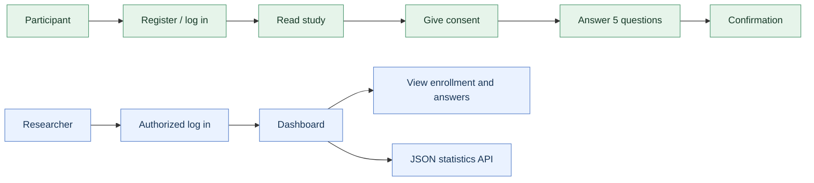
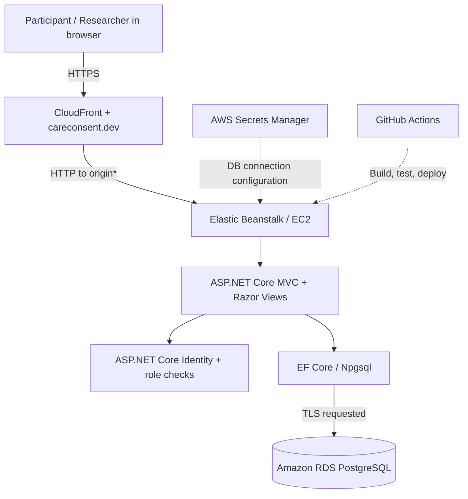
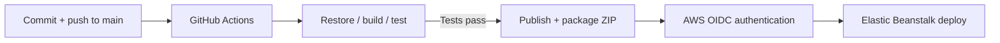

# CareConsent

**A small research-study web app that shows how participants give informed consent and how researchers securely review study responses.**

Participants register, read a fictional study, sign a consent form, and complete a five-question screening survey. Authorized researchers see enrollment progress, review submitted answers, and retrieve summary statistics. **All study content and demo accounts are fictional.**

**[Live demo](https://careconsent.dev)** · [How it works](#how-it-works) · [Security & privacy](#security-and-privacy) · [Architecture](#system-architecture) · [Testing & CI/CD](#testing-and-cicd) · [Technical docs](#dive-deeper)

> **Portfolio demonstration, not a clinical system.** Do not enter real personal or patient information. This project is not affiliated with a healthcare institution, does not conduct real research, and does not claim HIPAA compliance. See [security limitations](docs/security-and-privacy.md#current-limitations).

## The idea in 30 seconds

In a research study, participants need to understand what they are agreeing to, and researchers need an organized way to track consent and screening responses. **CareConsent demonstrates both sides in one application.**

| Participant | Researcher |
|---|---|
| Creates an account, reviews the study, consents, answers questions, and sees a confirmation. | Uses a provisioned researcher account to see enrollment statuses, review responses, and read study statistics. |

## How it works

**Important distinction:** Public registration always creates a **Participant** account. Researcher access is restricted; there is no self-service researcher registration or approval workflow in the current demo.

## System architecture

One simple ASP.NET Core application handles web pages, authorization, business rules, and an API. PostgreSQL stores the records. AWS hosts the app and its database.

## What I built

- **Participant journey:** account creation, study information, versioned consent, typed signature, validated questionnaire, and completion receipt.
- **Researcher journey:** role-restricted dashboard with counts for Started / Consented / Completed, participant emails, and per-enrollment response details.
- **Protected JSON API:** `GET /api/study/stats` returns counts only; access is restricted to researchers.
- **Database-backed workflow:** study, enrollment, consent, questions, and answers persisted using EF Core and PostgreSQL.
- **Tested deployment:** automated tests gate the GitHub Actions build before the app is published and sent to AWS Elastic Beanstalk.

## Security and privacy

Security was part of the design, not an afterthought.

| Control | How it works |
|---|---|
| **Authentication** | ASP.NET Core Identity manages registration, sign-in, and password hashing. |
| **Role-based access** | Participant and Researcher authorization checks run on the server. |
| **Record ownership** | Participant record queries filter by the signed-in user ID. |
| **Consent-first workflow** | Questions cannot be submitted before recorded consent; repeated submissions are blocked. |
| **Form protection** | Anti-forgery validation and server-side answer validation. |
| **Minimum researcher data** | Dashboard shows status and email; detail view excludes the typed signature and password fields. |
| **Credential management** | Database connection configuration is supplied through AWS Secrets Manager on deployment. |
| **Data boundaries** | Fictional seeded study; demo banner warns against entering real personal or health information. |

## Tech stack

| Layer | Technologies |
|---|---|
| Web UI | Razor Views, HTML, CSS, Bootstrap |
| Application | C#, .NET 10, ASP.NET Core MVC, REST-style JSON endpoint |
| Authentication / authorization | ASP.NET Core Identity, roles, authorization attributes |
| Data | Entity Framework Core, Npgsql, PostgreSQL |
| Automated testing | xUnit, `WebApplicationFactory`, EF Core InMemory provider |
| Cloud | Name.com domain/DNS, AWS CloudFront, Elastic Beanstalk (EC2), RDS, Secrets Manager, ACM |
| Delivery | GitHub Actions, AWS OIDC role, S3 application bundle |

## Data model

The app uses Identity users plus five main entities:

`Study` · `Enrollment` · `ConsentRecord` · `ScreeningQuestion` · `ScreeningAnswer`

Every participant can have **one enrollment per study**; each enrollment has at most one consent record and one response per question. The seeded **Daily Routines and Wellbeing Study** contains five invented, non-diagnostic questions.

## Testing and CI/CD

**86 automated tests** cover validation rules, participant flows, authentication, authorization, dashboard behavior, researcher details, and the JSON API. Integration tests run the ASP.NET Core app in memory with a test database; they do **not** require a live AWS database.

The workflow passed its build/test/deployment-command steps. **A green GitHub Actions run alone does not verify that Elastic Beanstalk completed deployment or that the public app is healthy**; those are checked separately in AWS and the browser. Schema migrations are applied separately, not automatically by CI/CD.

---

*CareConsent is a personal portfolio project developed with AI-assisted coding tools and human-directed design, review, testing, and deployment. It is a fictional-data demonstration, not a live research service.*
